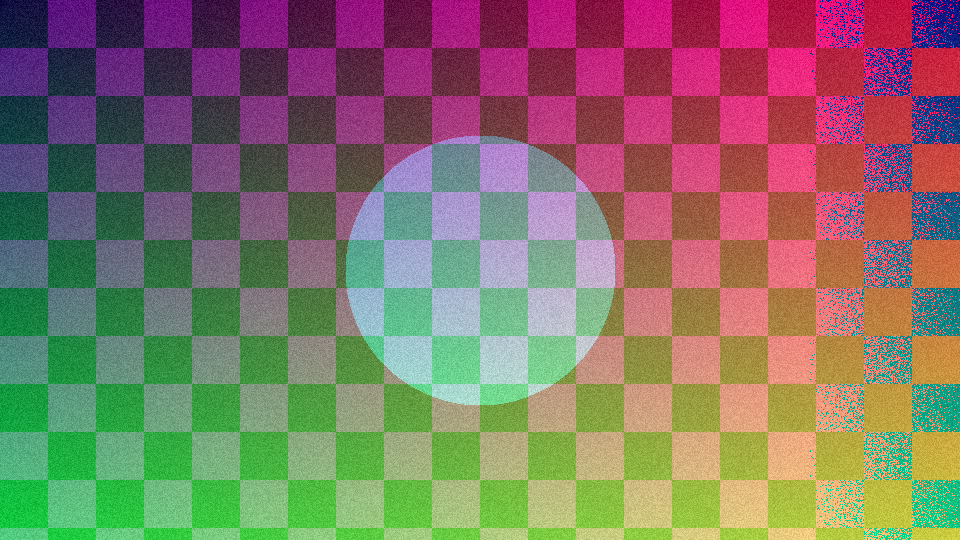
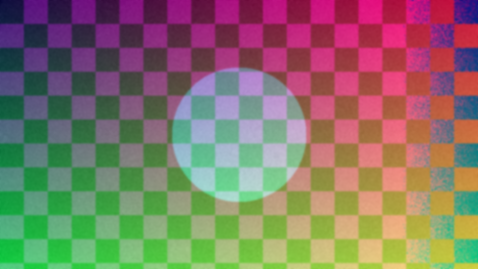
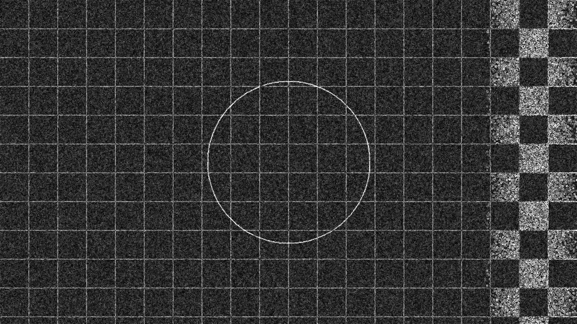

# ImageFilter

A C++17 command-line tool for Gaussian blur, Sobel edge detection, and bilinear resizing. Each filter can run on one thread or through a custom thread pool, so the two versions can be compared using the same code.

The full blur → edge → resize pipeline measured a **6.85× processing speedup** on a 4K test image with 10 workers on an Apple M4.

## Build

Requires a C++17 compiler and Make. Python 3.9+ is needed for the benchmark scripts and integration tests. The image libraries are included in `third_party/`, so the build works offline.

```sh
make -j4
```

CMake is also supported:

```sh
cmake -S . -B build-cmake -DCMAKE_BUILD_TYPE=Release
cmake --build build-cmake --parallel
ctest --test-dir build-cmake --output-on-failure
```

## Try it

The repository includes a generated sample image. These commands write new images to `results/`:

```sh
mkdir -p results

# Blur on a single thread.
./build/imagefilter apply --input examples/input.png --output results/blur-serial.png \
  --filter blur --mode serial

# Run the same filter with a pool of four workers.
./build/imagefilter apply --input examples/input.png --output results/blur-pool.png \
  --filter blur --mode pool --threads 4

# Detect edges or resize the image.
./build/imagefilter apply --input examples/input.png --output results/edges.png \
  --filter edge --threads 4
./build/imagefilter apply --input examples/input.png --output results/resized.png \
  --filter resize --resize 480x270 --threads 4

# Run all three filters in order.
./build/imagefilter apply --input examples/input.png --output results/pipeline.png \
  --filter pipeline --resize 480x270 --threads 4
```

Use `--radius` and `--sigma` to adjust the blur. Run `./build/imagefilter --help` for all options, including a command to generate a larger test image.

| Input | Gaussian blur | Sobel edges |
| --- | --- | --- |
|  |  |  |

## How the threading works

The pool keeps a fixed number of workers alive. Each filter pass places jobs in a shared queue, and workers claim 16-row batches using an atomic counter. This lets a worker take more rows as soon as it finishes its current batch.

Workers read the same input image and write to separate output rows. Each pass finishes before the next one starts, which matters for the horizontal and vertical blur passes. Passing no pool runs the same filter loops on the calling thread. The pool uses `std::thread`, mutexes, a condition variable, and futures.

## Results

Measured on a 3840×2160 RGB image using 10 workers on an Apple M4 with 10 CPU cores (4 performance and 6 efficiency). Resize output was 1920×1080. Times are medians from nine paired runs after two warmup pairs for each configuration.

| Filter | Single thread | Thread pool | Speedup |
| --- | ---: | ---: | ---: |
| Gaussian blur | 267.93 ms | 37.41 ms | 7.16× |
| Sobel edges | 21.41 ms | 5.04 ms | 4.25× |
| Bilinear resize | 12.21 ms | 1.91 ms | 6.41× |
| Full pipeline | 300.26 ms | 43.86 ms | **6.85×** |

These are processing times: allocations and thread-pool dispatch are included; image loading, saving, and pool startup are excluded. The benchmark checks that serial and parallel outputs match byte for byte. Results depend on the image, machine, and background load.

The [benchmark notes](benchmarks/README.md) include the full thread-count comparison and all 180 timing pairs.

## Run your own benchmark

```sh
python3 scripts/benchmark.py --threads 1,2,4,8,10
python3 scripts/report.py results --output results/report.md

# Use a different image.
python3 scripts/benchmark.py --input photo.jpg --threads 1,2,4
```

Without `--threads`, the program chooses a sweep based on the available hardware. Python starts the benchmark and saves metadata; the C++ program measures the filters and compares their outputs. The report script checks the saved timings and creates a Markdown table.

New runs go to `results/`, which Git ignores. The recorded Apple M4 measurements in `benchmarks/apple-m4/` are kept separately.

## Tests

```sh
make test
make sanitize
```

The tests check the filters against known results, compare serial and parallel output, exercise tiny images and invalid options, and check pool shutdown and exception handling. `make sanitize` runs the same checks with AddressSanitizer and UndefinedBehaviorSanitizer. A GitHub Actions workflow builds and tests the project on Linux and macOS.

## Project layout

```text
include/imagefilter/   Image, filter, and thread-pool headers
src/                   Filter implementations, image I/O, and CLI
tests/                 C++ tests and Python integration tests
scripts/               Benchmark runner and report generator
examples/              Generated input and filter outputs
benchmarks/            Recorded measurements and methodology
third_party/           stb headers, license, and version information
```

## Limitations

- Images are processed as 8-bit RGB. Alpha is dropped, and EXIF orientation and color profiles are not applied.
- Blur and edge detection clamp samples at the borders. Sobel magnitude is capped at 255.
- Bilinear resize has no anti-aliasing prefilter for large reductions.
- Small images may not benefit from threading. Workers share memory bandwidth, and the OS decides which cores they use.

## Dependencies and license

Image decoding and encoding use [stb_image and stb_image_write](https://github.com/nothings/stb). The filtering and thread-pool code are implemented in this project. The exact stb revision and file hashes are in [third_party/manifest.json](third_party/manifest.json).

Project code is licensed under [MIT](LICENSE). The stb files retain their [upstream license](third_party/STB_LICENSE).
